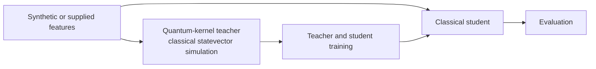

# DA-QKCA: Distillability-Aware Quantum Kernel Co-Adaptation

DA-QKCA is research software for studying how a quantum-kernel teacher and a classical student can be trained together. It includes differentiable fidelity-kernel models, feature selection, student models, training routines, classical baselines, and evaluation utilities.

The quantum circuits are evaluated with **exact classical statevector simulation**. This project does not run on quantum hardware and makes no claim of quantum advantage. The included smoke configuration uses synthetic data; it is a code check, not evidence for a scientific result or a real-world benchmark.

## How the pieces fit together



The package is organized around the kernel and feature-map code in `src/daqkca/quantum/`, student and selector models in `src/daqkca/models/`, and training and evaluation code in `src/daqkca/`.

## Quick start

Requires Python 3.11 or newer.

```powershell
python -m venv .venv
.venv\Scripts\Activate.ps1
python -m pip install -e ".[dev]"
```

Run the small synthetic smoke experiment:

```powershell
python scripts/run_smoke.py --config configs/smoke.yaml
```

Run the package tests with:

```powershell
python -m pytest
```

The smoke run trains a few methods on a small, generated XOR task. Its metrics are only useful for checking that the code executes; they should not be interpreted as benchmark results.

## Project contents

- `src/daqkca/` — package source for data loading, feature maps, kernels, models, training, and metrics.
- `configs/smoke.yaml` — small configuration for a fast functional run.
- `scripts/` — commands for smoke runs, individual experiments, baselines, plots, and gradient checks.
- `tests/` — unit and numerical checks for kernels, gradients, determinism, and data splitting.
- `data/` — synthetic-data documentation. No third-party dataset is included.

This code-only release omits the paper manuscript, review correspondence, full experiment configurations, and historical run records. The included scripts that expect a full experiment configuration need a compatible YAML file supplied with `--config`.

## Data and limitations

The included example generates synthetic IID data locally. It does not model network traffic, temporal dependence, host or session grouping, or other real-world data challenges. See [`data/DATASET_CARD_synthetic.md`](data/DATASET_CARD_synthetic.md) for the documented synthetic setup and limitations.

All quantum-kernel calculations here are classical simulations. Runtime and memory grow quickly with circuit size, and software tests do not establish model quality, generalization, or an advantage over classical methods. Check each configuration and protocol before using results in a research claim.

## Citation and license

The software is released under the MIT License. See [`CITATION.cff`](CITATION.cff) for software citation metadata; add the paper citation when a public paper record is available.
